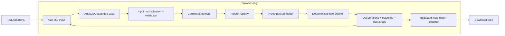

# IT Support Workbench — техническое задание и план реализации для Codex

> **Версия ТЗ:** 1.0 · **Дата:** 09.10.2026 · **Язык интерфейса:** русский · **Тип:** open-source, local-first веб-приложение · **Статус:** историческое исходное ТЗ; код реализован и развивается, текущее состояние в README.md и docs/ROADMAP.md
>
> **Главная установка для Codex:** реализуй **работающий MVP**, а не только набор красивых страниц. Диагностика должна быть детерминированной, тестируемой и объяснимой. Не пытайся получать доступ к компьютеру посетителя, выполнять системные команды или обрабатывать реальные корпоративные данные без разрешения.

## 0. Краткая формулировка продукта

**IT Support Workbench** — локально работающее в браузере рабочее место специалиста IT-поддержки: пользователь вставляет результаты стандартных команд Windows или открывает локальный `.txt`-файл, приложение структурирует вывод, подсвечивает наблюдаемые признаки, показывает доказательства и предлагает **следующие проверки**, а не безосновательно ставит диагноз. В следующих релизах появляются обучающий симулятор инцидентов, справочник команд, анализ нескольких команд, калькулятор подсетей и локальные отчёты.

Это **не** удалённый агент, антивирус, сканер корпоративной сети и не программа с административным доступом к чужим ПК. Сервер для обработки введённых данных **не требуется**. После загрузки статических файлов анализ выполняется на устройстве пользователя.

### Зачем разрабатывать

- Полезный GitHub-проект с содержательной логикой на TypeScript, а не очередной CRUD.
- Практика диагностики Windows 10/11, TCP/IP, DHCP, DNS, VPN, маршрутизации.
- Проверяемые навыки: парсинг полуструктурированных данных, rule engine, TypeScript, тесты, проектирование UX, безопасность.
- Возможность постепенно добавлять знания из учебной практики **без публикации внутренних данных работодателя**.

### Приоритет продукта

1. **Корректность интерпретации и прозрачность ограничений.**
2. **Конфиденциальность данных.**
3. **Быстрый полезный пользовательский сценарий.**
4. **Расширяемость без переусложнения.**
5. Качество интерфейса, мобильная адаптация и доступность.

---

## 1. Контекст, ограничения и принципы

### 1.1 Ограничения MVP (обязательные)

- Никаких виртуальных машин, Hyper-V, Docker, Windows Server или инфраструктурного развёртывания.
- Никаких программ/скриптов, автоматически устанавливаемых на ПК пользователей.
- Никаких Electron/Tauri/нативных API в MVP; приложение — статический сайт.
- Никаких backend-сервисов, базы данных на сервере, входа в аккаунт, регистрации, облачной синхронизации.
- Никаких автоматических CMD/PowerShell-вызовов на устройстве; браузер не имеет таких полномочий.
- Никаких прямых тестов корпоративных адресов из браузера, «ping из JavaScript», LAN scanning, «автоматической проверки VPN».
- Никаких внешних AI API и отправки пользовательского текста третьим лицам.
- Никаких реальных корпоративных логов/адресов/идентификаторов/имён пользователей в git, тестах и демо.
- Реальные материалы технической поддержки допускаются только после обезличивания **и** разрешения организации; по умолчанию работаем с синтетическими примерами.

### 1.2 Что умеет MVP v0.1

**Единый полностью рабочий вертикальный срез:** ввод → распознавание `ipconfig /all` → структурированная карточка адаптеров → безопасные диагностические правила → ссылки на исходные строки → локальный экспорт обезличенного отчёта.

Работающие возможности:

1. Публичный лендинг/дашборд с кнопкой «Открыть анализатор» и демопримером.
2. Страница `/analyzer` с переключателем «Вставить текст / Выбрать файл».
3. Автоматическое определение, похож ли ввод на `ipconfig /all`; ручной выбор типа команды как fallback.
4. Отображение карточек **нескольких сетевых адаптеров**, а не одного «общего IP».
5. Извлечение IPv4, IPv6, маски, шлюза, DNS, DHCP, MAC (чувствительные поля по умолчанию скрыты).
6. Вывод диагностических наблюдений с пояснением, степенью определённости, рекомендацией и исходными строками.
7. Состояния empty/loading/invalid/partial/success и предупреждения о неподдерживаемых форматах.
8. Загрузка безопасного встроенного примера; отдельная кнопка «Очистить всё».
9. Локальное скачивание **обезличенного** отчёта `.md` или `.txt` и отдельное явное подтверждение, если пользователь хочет включить исходные данные.
10. Юнит-тесты парсера и правил; UI/e2e smoke-тесты; CI.
11. Русскоязычный responsive UI, понятный без знания английского.

**Важно:** разделы, ещё не реализованные, не должны создавать видимость рабочей функциональности. Допускается «В разработке», но нельзя показывать фиктивные результаты и неработающие кнопки.

### 1.3 Следующие версии (не делать раньше MVP)

- **v0.2 — Network Outputs:** `ping`, `nslookup`, `tracert`, затем `route print`; агрегирование результатов нескольких команд и сравнение проверок.
- **v0.3 — Toolkit & Knowledge Base:** subnet calculator, справочник портов/команд, алгоритмы диагностики.
- **v0.4 — Troubleshooting Simulator:** интерактивные ветвящиеся учебные инциденты с оценкой действий.
- **v0.5 — Local Cases & Offline:** локальное сохранение *явно выбранных* кейсов, экспорт/импорт, возможная PWA после проверки безопасности.
- **v1.x — Advanced:** анализ EVTX только при наличии согласованного безопасного формата экспорта, расширенные правила, анонимизированное сравнение, пользовательские наборы учебных сценариев; AI только отдельной opt-in интеграцией с ясными рисками передачи данных.

---

## 2. Пользователи и главные сценарии

### Персона A — начинающий инженер IT-поддержки

Пришла заявка «не открывается сайт через VPN». Он знает команды, но не понимает, что проверять в выводе. Вставляет `ipconfig /all`, получает карту адаптеров и **гипотезы**, понимает следующий шаг: проверить резолвинг `nslookup`, маршрут, доступность нужного сервиса. Не получает ложное обещание, что программа «определила неисправность по одному выводу».

### Персона B — опытный системный администратор

Вставляет длинный вывод нескольких адаптеров, быстро находит DNS, шлюз и виртуальные/VPN-интерфейсы, экспортирует очищенный отчёт. Приложение не мешает ему «помогающими» автоматическими исправлениями.

### Персона C — обучающийся

Нажимает «Демопример», видит разбор и по ссылке на каждое наблюдение подсвечивает строки ввода. Позднее проходит симулятор типовых заявок.

### Основные user stories

- **US-01:** Как инженер, хочу вставить вывод команды и сразу увидеть извлечённые сетевые параметры.
- **US-02:** Хочу видеть, с какого **адаптера** и **строки** взято каждое значение.
- **US-03:** Хочу понимать, что является наблюдением, а что — предположением.
- **US-04:** Хочу без потери данных обработать несколько подключений Ethernet/Wi-Fi/VPN.
- **US-05:** Хочу использовать безопасные примеры, не обращаясь к корпоративным машинам.
- **US-06:** Хочу сформировать отчёт с редактированными чувствительными данными.
- **US-07:** Хочу, чтобы данные не отправлялись на сервер и не сохранялись без согласия.
- **US-08:** Хочу получить понятное сообщение при неизвестной локали/формате.

---

## 3. Технологии и обоснование выбора

| Слой | Решение | Причина |
|---|---|---|
| Язык | **TypeScript, strict** | Надёжные контракты парсеров и правил, безопасный рефакторинг |
| UI | **Vue 3 + Composition API (`<script setup>`)** | Знакомый стек, официальная поддержка TS |
| Сборка | **Vite** | Лёгкий и быстрый статический SPA |
| Маршруты | **Vue Router (hash history)** | Работает на GitHub Pages без серверного SPA fallback |
| UI-состояние | **Pinia** | Только выбранный пример/ввод, результат анализа, настройки отображения; бизнес-логика вне stores |
| Стили | **Tailwind CSS 4 + CSS custom properties** | Выразительный адаптивный UI + единые дизайн-токены; не смешивать с ещё одним UI-фреймворком |
| Иконки | **lucide-vue-next** | Небольшие SVG-иконки |
| Runtime validation | **Zod** | Строгие проверки импортируемых/экспортируемых JSON-структур, когда они появятся; парсер сырого вывода работает самостоятельно |
| Browser storage | **session-only по умолчанию**; IndexedDB + Dexie в v0.5 | Избежать незаметного хранения чувствительного вывода |
| Долгий парсинг | **Web Worker, по фактической необходимости** | Не блокировать интерфейс; парсеры — чистые функции |
| Юнит/компонентные тесты | **Vitest + Vue Test Utils** | Совместимость с Vite, рекомендовано Vue |
| E2E | **Playwright** | Проверка сценария от ввода до отчёта |
| Quality | **ESLint + Prettier + vue-tsc** | Поддерживаемый код, типизация компонентов |
| Публикация | **GitHub Pages + GitHub Actions** | Статический бесплатный демосайт, автоматические проверки |
| CI | **GitHub Actions** | lint, typecheck, unit, build, smoke e2e |
| Backend/серверная БД | **нет** | Для первой версии не нужны, нарушают local-first без пользы |
| ИИ | **нет** | Не нужен для строгого анализа; меньше ошибок и рисков утечки |

**Правило версий:** устанавливать поддерживаемые стабильные взаимосовместимые версии на дату реализации, фиксировать их в lockfile; не выдумывать точные номера версий в ТЗ. Использовать актуальную Node.js LTS, совместимую с выбранной версией Vite. Зафиксировать используемую major-версию Node через `.nvmrc` и `engines`, одинаковую в CI.

**Не включать сейчас:** Nuxt/Next.js, tRPC, NestJS, Prisma, PostgreSQL, Docker, SSR, микросервисы, Redis, Electron, централизованную телеметрию, платный UI kit, внешнюю аналитическую SDK.

### Почему не Node.js backend?

Node.js **нужен локально для разработки и сборки**, но не для выполнения приложения в браузере. После `npm run build` публикуются статические HTML/CSS/JS/assets. Никакая пользовательская диагностика на сервере не выполняется.

---

## 4. Архитектура: модульный monolith + functional core / imperative shell

**Стиль:** feature-first frontend, чёткое разделение *представления*, *сценариев использования*, *доменных типов* и *реализаций парсеров/правил*. Без абстрактных DI-контейнеров и ненужных интерфейсов для одной функции.



### Зависимости

```text
pages/components  → application/use-cases → domain/contracts
                             ↓
                    infrastructure/parsers
                             ↓
                    infrastructure/rules
                             ↓
                    infrastructure/export
```

Фактически слои могут взаимодействовать через небольшие чистые функции без жёсткого DI. Главное, чтобы **Vue-компоненты не содержали regex-парсинг**, а сами парсеры **не импортировали Vue, DOM, Pinia, Fetch**.

### Цепочка обработки

1. `InputSource`: paste / file / built-in fixture.
2. Validate: не пустой, размер, бинарность, расширение и кодировка файла.
3. Decode: файлы `.txt`/`.log`, UTF-8 с BOM и ручной выбор при необходимости `windows-1251` / `ibm866`; при ошибках декодирования — понятное предупреждение. Сырой pasted text декодировать не нужно.
4. Normalize line endings `\r\n`, `\r` → `\n`, сохранять 1-based номера нормализованных строк. Никакой неявной «чистки» строк, ломающей доказательства.
5. Detect: `ipconfig` с оценкой распознавания, если неопределённо — предложить выбрать тип вручную.
6. Parse: вернуть структурированный результат + warnings + non-fatal errors; не бросать exception на обычном неподдержанном тексте.
7. Evaluate: правила только над типизированным результатом; выдать evidence с источником.
8. Render: dashboard адаптеров, наблюдения, поля «Что проверить дальше».
9. Export: по умолчанию отчёт с замаскированными идентификаторами; **сырой ввод не включать** автоматически.

### Структура регистрации команд

Новые команды добавляются через реестр `{kind, detect, parse, analyze, examples}`; каждый парсер отвечает только за свой формат. У нескольких команд может быть общий engine наблюдений, но нельзя «подгонять» формат `ping` под модель `ipconfig`.

---

## 5. Контракты доменной модели (ориентир для реализации)

Код ниже — **описание типов**, Codex адаптирует при реализации, не создавая лишних абстракций.

```ts
type CommandKind = 'ipconfig' | 'ping' | 'nslookup' | 'tracert' | 'route';
type ParseStatus = 'ok' | 'partial' | 'unsupported' | 'invalid';
type Severity = 'info' | 'warning' | 'critical';
type Confidence = 'high' | 'medium' | 'low';
type EvidenceRange = { startLine: number; endLine: number };

type DiagnosticEvidence = {
  field?: string;
  adapterId?: string;
  range: EvidenceRange;
  excerpt?: string; // только в runtime памяти; редактировать перед экспортом
};

type DiagnosticFinding = {
  id: string;
  ruleId: string;
  severity: Severity;
  confidence: Confidence;
  title: string;
  explanation: string;
  whatItDoesNotProve?: string;
  nextChecks: Array<{ label: string; why: string; safeReadOnlyCommand?: string }>;
  evidence: DiagnosticEvidence[];
};

type Adapter = {
  id: string;
  displayName: string;
  mediaState?: 'connected' | 'disconnected' | 'unknown';
  description?: string;
  ipv4: Array<{ address: string; prefixLength?: number; mask?: string; line: number }>;
  ipv6: Array<{ address: string; line: number }>;
  gateways: Array<{ value: string; line: number }>;
  dnsServers: Array<{ value: string; line: number }>;
  dhcpEnabled?: boolean;
  dhcpServer?: string;
  macAddress?: string;
  sourceRange: EvidenceRange;
};

type ParsedIpconfig = {
  kind: 'ipconfig';
  computerName?: string;
  adapters: Adapter[];
};

type ParseResult<T> = {
  status: ParseStatus;
  kind: CommandKind | 'unknown';
  value?: T;
  warnings: Array<{ code: string; message: string; range?: EvidenceRange }>;
};

type AnalysisResult<T> = {
  schemaVersion: 1;
  parserVersion: string;
  createdAt: string;
  parse: ParseResult<T>;
  findings: DiagnosticFinding[];
  // raw input не включать в экспортируемый AnalysisResult
};
```

**Важные детали:**

- Нет одной глобальной «истины» `dns` / `gateway`; значения принадлежат **адаптерам**.
- Одновременно возможны DHCP IPv4, несколько DNS, отсутствие шлюза и link-local IPv6.
- Недостающие поля — `undefined`/пустой массив, а не выдуманный адрес `0.0.0.0`.
- Для ошибок парсинга статусы раздельны: `invalid` — ввод не годится; `unsupported` — похож на другой формат; `partial` — данные есть, но не всё прочитано.
- Если `critical` = тревожный признак, не переводить его автоматически в «доказана поломка».
- Типизированные модели должна покрывать отдельная валидация экспортируемых данных при импорте в будущих релизах.
- `id` адаптера в рамках текущего разбора должен быть стабильным (напр. индекс + slug заголовка), но не создавать скрытых постоянных идентификаторов компьютера.

---

## 6. MVP: спецификация парсера `ipconfig /all`

### 6.1 Поддерживаемый ввод

- Windows 10/11/Server; текстовый вывод **CMD `ipconfig /all`** (экспериментально Windows на RU и EN).
- Несколько секций Ethernet, Wi-Fi, virtual adapters, VPN, tunnel/loopback.
- Разные переносы строк, лишние пробелы и точки вокруг «:`», пустые строки.
- Учитывать, что значение шлюза/DNS в выводе может продолжаться на следующей строке **без нового заголовка поля**.
- IPv4 с пометками `(Preferred)` / `(Основной)` и IPv6 с zone index `%n`.
- Доменный суффикс и hostname допускается читать, но по умолчанию не показывать в экспортируемых отчётах.
- Не предполагать обязательное присутствие шлюза у VPN/виртуального адаптера.
- Отдельно обрабатывать `Media disconnected` / `Среда передачи недоступна` (и локализованные варианты), не объявлять отсутствие IP критическим для отключённого адаптера.

### 6.2 Что не обещаем

- Не поддерживаем произвольные полные PowerShell-объекты или скриншоты.
- Не выполняем автоматическое распознавание любого языка мира.
- Не знаем, какой адаптер обслуживает конкретный корпоративный маршрут, без `route print` и дополнительного контекста.
- Не определяем доступность интернета лишь по наличию шлюза/DNS в конфигурации.
- Не делаем вывод «DNS неисправен» по факту назначения нестандартного DNS-сервера.

### 6.3 Алгоритм разбора

1. Нормализовать только переносы строк; зафиксировать массив исходных строк.
2. Определить начало секций адаптеров по устойчивым RU/EN признакам заголовка, не только буквальному `Ethernet adapter`.
3. До первой секции разобрать общие свойства (если они есть), не смешивая с адаптером.
4. Для каждой секции разбирать известные поля по whitelist RU/EN шаблонов, терпимо к промежуточным точкам.
5. Для DNS/gateway объединять строки-продолжения, пока они похожи на адреса IPv4/IPv6 и не начинается новое поле.
6. Адреса проверять корректной функцией IPv4/IPv6, не «regex вида `\\d+` без контроля октетов».
7. IPv4 mask преобразовывать в prefix length **только если она является непрерывной маской**.
8. Каждое обнаруженное поле снабжать `line` / evidence range.
9. Неизвестные строки оставлять в предупреждениях/для отладки, но не «догадываться» об их смысле.
10. Запретить исключения при повторяющихся полях, битых и урезанных данных; возвращать `partial` и warnings.

### 6.4 Пример синтетического ввода (не настоящие данные)

```text
Windows IP Configuration

   Host Name . . . . . . . . . . . : DEMO-PC

Ethernet adapter Ethernet:

   Connection-specific DNS Suffix  . : lab.example
   Description . . . . . . . . . . . : Demo Ethernet Adapter
   Physical Address. . . . . . . . . : 02-00-00-00-00-01
   DHCP Enabled. . . . . . . . . . . : Yes
   IPv4 Address. . . . . . . . . . . : 192.0.2.10(Preferred)
   Subnet Mask . . . . . . . . . . . : 255.255.255.0
   Default Gateway . . . . . . . . : 192.0.2.1
   DHCP Server . . . . . . . . . . . : 192.0.2.2
   DNS Servers . . . . . . . . . . . : 192.0.2.53
                                       192.0.2.54

Wireless LAN adapter Wi-Fi:

   Media State . . . . . . . . . . . : Media disconnected
```

> Адреса `192.0.2.0/24` принадлежат документационному диапазону TEST-NET-1 (RFC 5737). Для тестов применять его и другие документационные диапазоны, а не реальные корпоративные адреса.

### 6.5 Ожидаемое поведение на примере

- Два адаптера, первый со списком из двух DNS-серверов, второй «отключён».
- У первого `DHCP Enabled: Yes`, IPv4 `192.0.2.10`, маска `/24`, шлюз `192.0.2.1`.
- Не выдавать `critical`, если нет свидетельства сбоя.
- Сообщение: «Конфигурация обнаружена; по одному `ipconfig` нельзя подтвердить доступность шлюза или исправность DNS».
- Клик по DNS должен подсветить исходную строку **и строку-продолжение**.

---

## 7. Диагностический rule engine: безопасность выводов

### 7.1 Общая идея

Правила — чистые функции от типизированной модели и доступных свидетельств к `DiagnosticFinding[]`. Никакой LLM, случайных ответов и сетевых запросов.

```ts
interface DiagnosticRule<T> {
  id: string;
  title: string;
  appliesTo: 'ipconfig' | 'ping' | 'nslookup' | 'route';
  evaluate(input: T): DiagnosticFinding[];
}
```

- Каждое правило имеет уникальный ID и юнит-тесты.
- Контекст `adapterId` учитывается в формулировке.
- Одно наблюдение = один объяснимый факт + следующий безопасный шаг.
- Если признаков недостаточно — явно писать «Недостаточно данных».
- «Более вероятно», «может указывать» вместо «точно сломано».
- Правила не изменяют систему; рекомендуемые команды **только для чтения** в MVP.
- Правила нельзя включать/выключать из внешних файлов, не прошедших валидацию/ревью.

### 7.2 Правила для v0.1

| Rule ID | Признак | Вывод | Ограничение / следующий шаг |
|---|---|---|---|
| `NET-001` | Активный DHCP-адаптер с IPv4 `169.254.0.0/16` | Возможна проблема с получением IPv4 по DHCP (APIPA) | Не доказывает отказ DHCP; проверить статус линка и `ipconfig /all`/DHCP |
| `NET-002` | Адаптер отключён, нет IPv4 | Информационный статус «адаптер не подключён» | Это может быть нормально; не повышать до critical |
| `NET-003` | Активный адаптер с IPv4, но без шлюза | Возможное ограничение выхода за пределы локальной сети **через этот адаптер** | Нормально для VPN/изолированных интерфейсов, контекст других адаптеров обязателен |
| `NET-004` | Не указаны DNS для активного адаптера | DNS в секции адаптера не обнаружены | Может использоваться иная конфигурация/политика; выполнить `nslookup` |
| `NET-005` | IPv4 маска невалидна | Ошибка/частичная интерпретация строки конфигурации | Не утверждать, что Windows использует именно такую маску: исходник может быть повреждён |
| `NET-006` | DNS в нескольких строках | Несколько DNS-серверов обнаружено | Это нормально; не объявлять ошибкой |
| `NET-007` | Есть VPN/virtual-like adapter | Обнаружен возможный виртуальный/VPN-интерфейс | Название не гарантирует, что VPN подключён и маршруты работают |
| `NET-008` | Некорректный/неполный формат | Частичный разбор | Предложить вручную выбрать формат и проверить кодировку |

**Дополнительные guardrails:**

- Нельзя диагностировать «нет интернета» из `169.254` на **одном** адаптере, если другой адаптер рабочий.
- RFC1918-адрес (`10/8`, `172.16/12`, `192.168/16`) **не является проблемой**.
- У `127.0.0.1`, IPv6 link-local `fe80::/10` и DHCP не должно быть ошибочной классификации.
- Метрики, шлюз, split/full tunnel **не определяются** из `ipconfig` с достаточной уверенностью.
- Флажок «Критично» не использовать для неподтверждённых догадок.
- Все рекомендации должны иметь условия применимости и не навязывать изменение DNS на публичный (что может сломать корпоративные ресурсы).

### 7.3 Модель «доказательства»

На карточке наблюдения:

```text
[Предупреждение · средняя уверенность]
У адаптера Ethernet обнаружен адрес из диапазона 169.254.0.0/16.

Почему это важно:
В некоторых случаях Windows назначает такой IPv4, когда DHCP не выдаёт адрес.

Доказательство: строки 14–15 (открыть в исходном тексте).

Что проверить:
1. Подключён ли нужный интерфейс.
2. Показан ли DHCP как включённый.
3. Получил ли другой сетевой интерфейс действующий адрес.

Не следует считать это доказательством недоступности интернета.
```

---

## 8. UX/UI и дизайн-система

### 8.1 Визуальное направление

**Professional diagnostic console** — современный инструмент инженера, а не футуристическая «хакерская панель». Использовать тёмный режим по умолчанию, светлый доступен, контраст и legibility важнее декора.

- Sidebar на desktop, компактная навигация на mobile.
- Карточки с чёткой иерархией, аккуратные границы, достаточные отступы.
- Моноширинный шрифт **только** для команд/логов/адресов, основной — системный UI sans-serif.
- Акцентный цвет (один) для интерактивности; красный только для подтверждённых ошибок, нейтральные предупреждения.
- Без тяжёлых графиков, фальшивых анимаций «сканируется сеть» и выдуманных чисел uptime.
- В анимациях учитывать `prefers-reduced-motion`.
- Тексты ошибок простым русским языком, без чрезмерной технической терминологии.

### 8.2 Разделы навигации

```text
IT Support Workbench
  Обзор              /
  Анализатор         /analyzer      [MVP: рабочий]
  Инструменты        /toolkit       [после v0.2]
  Справочник         /knowledge     [после v0.2]
  Тренажёр           /simulator     [после v0.3]
  О проекте          /about         [MVP: рабочий]
```

Реализовать `/` `/analyzer` `/about` в MVP; остальные маршруты разрешается **не добавлять**, чтобы не показывать пустые страницы. Когда появятся — подключить через lazy loading.

### 8.3 Экран анализатора — desktop

```text
┌──────────────────────────────────────────────────────────────────┐
│ IT SUPPORT WORKBENCH                        LOCAL PROCESSING ●   │
├────────────┬─────────────────────────────────────────────────────┤
│ Обзор      │ Анализ сетевой конфигурации                         │
│ Анализатор │ [Вставить текст] [Файл .txt] [Демопример]           │
│ О проекте  │                                                     │
│            │ ┌─────────────────────────────────────────────────┐ │
│            │ │ Windows IP Configuration ...                   │ │
│            │ │ Ethernet adapter Ethernet: ...                 │ │
│            │ └─────────────────────────────────────────────────┘ │
│            │ [Проанализировать] [Очистить]                      │
│            │                                                     │
│            │ Адаптеры (2)     Наблюдения (3)                      │
│            │ ┌───────────────────┐ ┌──────────────────────────┐ │
│            │ │ Ethernet          │ │ Признак / важность /     │ │
│            │ │ IPv4 / Mask / DNS │ │ доказательства / шаги    │ │
│            │ └───────────────────┘ └──────────────────────────┘ │
│            │ [Скачать обезличенный отчёт]                     │
└────────────┴─────────────────────────────────────────────────────┘
```

### 8.4 UI состояния

| Состояние | Поведение |
|---|---|
| Нет данных | Призыв вставить текст или загрузить демопример |
| Обрабатываем | Ненавязчивый progress, не имитировать долгую «системную проверку» |
| Успех | Карточки адаптеров и факты с ссылками на строки |
| Частично разобрано | Отображать достоверные поля + причины неопределённости |
| Неизвестная команда | Сказать, что поддерживается только `ipconfig /all` в v0.1 |
| Слишком большой файл | Предупреждение о лимите; ничего не сохранять |
| Ошибка кодировки | Выбор кодировки и повторное чтение файла |
| Экспорт | Указать, какие данные будут сохранены/маскированы |

### 8.5 Доступность

- Семантический HTML, labels, keyboard navigation, видимый focus, контраст WCAG AA.
- Не передавать состояние только цветом: текст + иконка.
- Области `aria-live` для статуса анализа, не объявлять каждую строку.
- Mobile минимум 360px: редактор и результаты размещаются вертикально.
- В длинных логах line-wrap доступен как toggle, по умолчанию горизонтальная прокрутка вместо поломки форматирования.
- Команды/значения можно копировать отдельно; копирование потенциально приватных полей требует явного клика.

---

## 9. Приватность и безопасность

### 9.1 Модель угроз

Источник ввода недоверенный: произвольные строки, HTML/JS фрагменты в логах, огромные файлы, нестандартные кодировки и возможные секреты (hostnames, internal DNS, MAC, локальные IP, доменные суффиксы). Мы **не исполняем** ни одну строку из входного текста.

### 9.2 Обязательные меры

- Не отправлять введённый текст на серверы, внешние API, LLM, telemetry/analytics, logging/Sentry.
- Не логировать raw input в консоль браузера, ошибки, CI-artifacts и GitHub Issues.
- По умолчанию хранить ввод **только в памяти вкладки**, стирать при обновлении/закрытии. Не писать в `localStorage`, IndexedDB, URL, history и session restore приложения.
- Кнопка «Очистить» сбрасывает все ссылки на ввод, найденные raw excerpts и результаты.
- Применять только текстовый вывод (`v-text`/интерполяция Vue, `textContent`), **никогда `v-html` на пользовательском вводе**.
- Ссылки в тексте не превращать автоматически в кликабельные URL.
- Импорт `.txt`/`.log`, рекомендованный лимит **2 MiB** в MVP; при превышении — отказ, не truncate незаметно.
- Проверять содержимое файла, отклонять NUL/бинарные данные; MIME/расширение не считать доказательством текстового содержимого.
- Не создавать ObjectURL для пользовательского HTML; для экспорта только сгенерированный plaintext, Blob `text/plain`/`text/markdown`.
- Маскировать в отчётах по умолчанию hostname, доменные суффиксы, MAC, частные IP (и, по возможности, чувствительные IPv6); адреса RFC 5737/демо оставить понятными. Показывать preview отчёта перед сохранением.
- Исключить реальный вывод из fixtures/README/screenshots/issue templates.
- В публичном README предупреждать: сайт не предназначен для загрузки корпоративных логов без разрешения.
- Строгий CSP при размещении в среде с поддержкой HTTP headers. Для GitHub Pages, где нельзя задавать произвольные заголовки, минимизировать сторонние скрипты и избегать inline-скриптов; при необходимости использовать meta CSP как частичную меру, не обещать полный эквивалент заголовков.
- Зависимости с lockfile, `npm audit` как вспомогательный контроль; секретов в git и клиентских env нет.
- Никаких удалённых шрифтов/CDN/API-ключей; всё бандлить локально.
- В будущем импорт JSON проверять Zod и `schemaVersion`; не использовать `eval`.

### 9.3 Редактирование данных — границы гарантий

**Автоматическое маскирование не гарантирует полного удаления персональных/корпоративных данных.** Экспорт должен содержать предупреждение и возможность просмотра; по умолчанию безопаснее экспортировать только семантические результаты и rule IDs **без исходных строк**. Режим с raw input — за отдельным подтверждением.

### 9.4 Offline ≠ local-first

Браузерная обработка не означает, что статический сайт доступен офлайн при первом посещении. Офлайн-функциональность (PWA/service worker) — **после MVP** и отдельного тестирования caching/version updates. Уже открытая страница может продолжать локально анализировать данные, если нужные скрипты загружены.

---

## 10. Структура репозитория (целевое дерево MVP)

```text
it-support-workbench/
├── .github/
│   ├── workflows/
│   │   ├── ci.yml
│   │   └── deploy.yml
│   └── ISSUE_TEMPLATE/
│       ├── bug_report.yml
│       └── feature_request.yml
├── docs/
│   ├── ARCHITECTURE.md
│   ├── SECURITY.md
│   ├── ROADMAP.md
│   ├── PARSERS.md
│   ├── TESTING.md
│   └── CONTRIBUTING.md
├── public/
│   └── favicon.svg
├── src/
│   ├── app/
│   │   ├── App.vue
│   │   ├── main.ts
│   │   └── router.ts
│   ├── pages/
│   │   ├── HomePage.vue
│   │   ├── AnalyzerPage.vue
│   │   └── AboutPage.vue
│   ├── features/
│   │   └── network-analysis/
│   │       ├── components/
│   │       │   ├── AnalyzerInput.vue
│   │       │   ├── AdapterCard.vue
│   │       │   ├── FindingCard.vue
│   │       │   ├── EvidenceViewer.vue
│   │       │   └── ReportPreview.vue
│   │       ├── model/
│   │       │   └── useAnalysisStore.ts
│   │       └── application/
│   │           └── analyzeOutput.ts
│   ├── domain/
│   │   ├── types/
│   │   │   ├── diagnostic.ts
│   │   │   ├── network.ts
│   │   │   └── commands.ts
│   │   └── rules/
│   │       ├── ipconfigRules.ts
│   │       └── ipconfigRules.test.ts
│   ├── infrastructure/
│   │   ├── parser/
│   │   │   ├── detectCommand.ts
│   │   │   ├── normalizeInput.ts
│   │   │   ├── ipconfigParser.ts
│   │   │   ├── ipconfigParser.test.ts
│   │   │   └── parserRegistry.ts
│   │   ├── files/
│   │   │   └── readTextFile.ts
│   │   └── export/
│   │       ├── redact.ts
│   │       ├── exportReport.ts
│   │       └── redact.test.ts
│   ├── shared/
│   │   ├── components/
│   │   │   ├── AppSidebar.vue
│   │   │   ├── AppHeader.vue
│   │   │   └── EmptyState.vue
│   │   └── styles/
│   │       └── tokens.css
│   ├── fixtures/
│   │   ├── ipconfig-en-normal.txt
│   │   ├── ipconfig-ru-normal.txt
│   │   ├── ipconfig-apipa.txt
│   │   ├── ipconfig-disconnected.txt
│   │   ├── ipconfig-multi-adapter.txt
│   │   ├── ipconfig-partial.txt
│   │   └── ipconfig-malicious-text.txt
│   └── env.d.ts
├── e2e/
│   ├── analyzer.spec.ts
│   └── privacy.spec.ts
├── index.html
├── package.json
├── package-lock.json
├── tsconfig.json
├── vite.config.ts
├── playwright.config.ts
├── eslint.config.js
├── .prettierrc.json
├── .gitignore
├── .nvmrc
├── LICENSE
└── README.md
```

**Допустимо** скорректировать названия по соглашениям Vue/Vite, но сохранить смысл разделения: UI, use case, чистый parser, чистый rule engine, export, fixtures, tests. Не строить полноценный monorepo ради одной SPA.

---

## 11. Требования к качеству кода

- `tsconfig` строгое: `strict: true`, не использовать `any` без обоснования.
- Чистые, экспортируемые функции `parseIpconfig(text)`, `evaluateIpconfig(parsed)`, `redactReport(result)`.
- В бизнес-логике не использовать Vue refs/DOM/таймеры/HTTP.
- Тексты UI — русский, имена кода/коммитов — английский.
- Не смешивать модель (`Adapter`) с UI state (`expandedAdapterIds`, `selectedTab`).
- Не полагаться на точное число пробелов/точек в русских и английских строках Windows.
- Проверка IP адресов должна иметь отдельные тесты: 0–255, IPv6 в разных формах, маски, prefix.
- Регистрация новых парсеров — добавлением файла/команды, без правок десятков компонентов.
- Нормальные пустые и ошибочные состояния, ошибки пользователю без stack trace.
- Идентификаторы правил стабильные, версионирование export schema.
- Модели и лицензии сторонних пакетов совместимы с open source.
- Конфигурации должны работать `npm ci`, `npm run dev`, `npm run build`, `npm run test`.

---

## 12. Тестовая стратегия

### 12.1 Фикстуры (строго синтетические)

1. EN: 1 активный Ethernet, DHCP, 2 DNS.
2. RU: 1 Ethernet, localized labels и «(Основной)».
3. EN: Ethernet + отключённый Wi-Fi.
4. RU: несколько адаптеров + VPN-подобное имя.
5. DHCP APIPA `169.254.x.x` при отсутствии другого активного адаптера.
6. APIPA на одном + нормальная конфигурация на другом (не говорить «нет интернета»).
7. Static IPv4, DHCP Off, без DHCP Server (валидно).
8. IPv6-only adapter и DNS IPv6.
9. IPv4 + IPv6 gateways/DNS и multiline continuation.
10. `Default Gateway` пустой у виртуального адаптера (нормально).
11. Несколько IPv4 адресов на одном адаптере.
12. MAC отсутствует или пустой — не падать.
13. Некорректная маска — partial/warning.
14. Испорченный адрес `999.999.999.999` — reject field, warning.
15. CRLF, LF, CR, лишние пробелы, табуляция.
16. Частичный вывод после копирования из терминала.
17. Строка HTML `` — выводится как текст; скрипт не исполняется.
18. Случайный текст — `unsupported` или `invalid`, а не фиктивные результаты.
19. Пустой ввод и ввод только пробелами.
20. Большой файл >2MiB — отказ.
21. ANSI/UTF-8 BOM и CP1251/CP866 в file import (если поддержка заявлена).
22. Нет активных интерфейсов — информационный статус.
23. Отсутствие `ipconfig /all` маркеров, но есть знакомые поля — слабое обнаружение + ручной выбор.
24. Смешанные RU/EN метки.
25. Неизвестные дополнительные поля Windows.

### 12.2 Unit tests

- На каждое поле — корректный parsing и номер строки.
- `NET-001`–`NET-008` позитивные и негативные тесты.
- `evaluateIpconfig` не изменяет входной объект.
- Одни и те же данные дают одинаковый результат (кроме времени, которое передаётся отдельно).
- Нет false-positive `169.254` на отключённом адаптере.
- Нет false-positive «нет шлюза = нет интернета».
- Redaction: masked hostname/MAC/local addresses, сохранение rule IDs и counts.
- Табличные edge cases для mask/prefix.

**Покрытие:** ориентир ≥85% statements/branches для `domain/rules`, `infrastructure/parser`, `infrastructure/export`; не гнаться за общим процентом путём поверхностных UI-тестов.

### 12.3 Component/e2e

- Можно вставить пример и нажать «Проанализировать».
- Виден правильный счётчик адаптеров.
- Раскрытие evidence приводит к соответствующим исходным строкам.
- Предупреждение для unsupported content.
- Файл выбрали локально — анализ работает без POST/внешнего HTTP.
- Экспорт скачивает файл с ожидаемым маскированием.
- После «Очистить» нет пользовательского ввода/результата.
- При reload текущий введённый текст не восстанавливается.
- XSS fixture отображается текстом.
- Маршруты работают под вложенным путём GitHub Pages.
- Мобильный размер 375×812: нет сломанной горизонтальной вёрстки навигации.

### 12.4 CI pipeline

В PR и push в main:

```text
npm ci
npm run lint
npm run typecheck
npm run test:unit -- --run
npm run build
npm run test:e2e
```

Codex может адаптировать `package.json` команды (например, `test:unit` без `-- --run`) для консистентности; **пайплайн должен реально выполняться**. Для PR e2e — Chromium достаточно, Firefox/WebKit можно добавить позже. Деплой на Pages **только после успешного CI на main**, с минимальными разрешениями GitHub token.

---

## 13. План разработки с точным scope

### M0 — Project foundation (первый коммит)

**Действия Codex:**

- Инициализировать Vite + Vue + TypeScript, Node LTS, ESLint/Prettier.
- Настроить Vue Router hash, Pinia, Tailwind, дизайн-токены.
- Реализовать реальные маршруты `/`, `/analyzer`, `/about` и адаптивный layout.
- Создать README, ARCHITECTURE, ROADMAP, SECURITY, LICENSE, `.gitignore`.
- Ввести npm scripts и пустой базовый unit-test.
- Создать git workflow CI и проверить локальный build.

**Done:** app открывается, навигация/темы работают, `npm ci`+`lint`+`typecheck`+`test`+`build` проходят.

### M1 — Core parser MVP

**Действия Codex:**

- Определить типы и статус парсинга.
- Реализовать `normalizeInput`, `detectCommand`, `parseIpconfig`.
- Добавить fixture RU/EN, multi-adapter, partial, malformed.
- Компоненты Input + AdapterCard + EvidenceViewer.
- Юнит-тесты: поля, продолжения, локали, источники строк.

**Done:** синтетический пример даёт корректную структурированную модель, источник каждого поля прослеживается до строки.

### M2 — Deterministic rules + UI

**Действия Codex:**

- Ввести `DiagnosticRule` и `NET-001`…`NET-008`.
- Реализовать `FindingCard`, сортировку по severity/confidence.
- Статусы partial/invalid/unsupported и предупреждения.
- Реализовать демопример и ясное сообщение «анализ не означает сетевое сканирование».
- Протестировать отсутствующие/дополнительные поля.

**Done:** результаты объяснимы, у каждого вывода есть evidence и next steps, false positives из раздела 7 не проходят.

### M3 — Privacy + Export

**Действия Codex:**

- File import `.txt`/`.log` с лимитом 2MiB и обработкой кодировки.
- Redaction по умолчанию и report preview.
- Экспорт Markdown без raw input; raw export только после явного подтверждения.
- Тесты на утечки и XSS.
- Убедиться, что нет persistence/analytics.

**Done:** пользователь может сохранить полезный обезличенный отчёт, реальные значения по умолчанию не раскрываются.

### M4 — QA + public release v0.1

**Действия Codex:**

- Добавить Playwright e2e и достаточное тестовое покрытие.
- Настроить GitHub Actions CI + GitHub Pages deploy.
- Протестировать mobile, keyboard, dark/light, empty/error.
- Проверить корректную Vite `base` и hash routes.
- Добавить GIF/скриншоты **только на синтетических fixtures**.
- Обновить README: возможности, ограничения, screenshots, roadmap, запуск, безопасность.

**Done:** есть публичный demo с рабочим анализом `ipconfig`, тестами и правдивым README.

### M5 — v0.2: Multiple commands

**Только после завершения M0–M4.**

- Добавить `ping` parser (RU/EN): packets sent/received/lost, RTT, target; ICMP timeout ≠ достоверно хост выключен.
- Добавить `nslookup` parser: DNS server, query domain, answer, timeout/NXDOMAIN/servfail по доступному выводу; учитывать RU/EN.
- Добавить `tracert` parser: hops, RTT, `*` timeout; отсутствие ответа одного хопа не означает разрыв маршрута.
- Добавить `route print` parser: IPv4/IPv6 route entries, interface, metric; отдельно анализ route selection и влияние VPN **без попытки однозначной диагностики при недостатке данных**.
- Добавить `AnalysisSession` — несколько выводов/команд, сопоставленных пользователем по времени/контексту, без скрытого объединения разных компьютеров.
- Ввести сравнительный view «до/после VPN», явные метки времени от пользователя, только локальные данные.

**Итерационный принцип:** один новый parser = отдельный issue, fixtures, unit tests, observability и UI, затем merge.

### M6 — v0.3: Toolkit

- Calculator IPv4 CIDR: network, broadcast, first/last host, masks, подсеть; корректно обработать `/31`, `/32`.
- Библиотека только read-only команд Windows + пояснения; dangerous commands — отдельный раздел с предупреждением, не выдавать массовые исправления.
- Knowledge Base: Markdown/JSON карточки с источником, версией, датой проверки и тегами (DNS, DHCP, Windows Update, VPN, Printer, AD, Cameras).
- Поиск client-side, клавиатура, ссылки на первичные источники.

### M7 — v0.4: Troubleshooting Simulator

- Детерминированный сценарный движок (JSON сценарии + валидатор), без AI.
- Инциденты: `INC-DNS-001`, `INC-VPN-001`, `INC-WINUPDATE-001`, `INC-PRINT-001`, `INC-CAMERA-001`, `INC-SCALES-001`.
- Интерактивные ходы «Что проверить?», выдача симулированных результатов, баллы за диагностическую последовательность и безопасные действия.
- **Не имитировать полномочия** на изменение реальных камер/весов; сценарии касс/весов — теоретические и vendor-agnostic, с пометкой о регламентах.
- Отдельные fixtures, сценарии воспроизводимы и версионируются.

### M8 — v0.5: Local Cases

- По умолчанию данные всё ещё ephemeral.
- Сохранение кейса **только по явному opt-in** в IndexedDB (Dexie), удаление всех кейсов.
- Export/import JSON с `schemaVersion`, Zod validation, preview, предупреждение о приватности.
- Если включена PWA: документировать, что offline cache хранит код приложения; не кешировать пользовательские логи автоматически.

---

## 14. GitHub Issues (готовый backlog)

| # | Priority | Issue | Milestone | Acceptance |
|---|---|---|---|---|
| 1 | P0 | `chore: bootstrap Vue 3/Vite/TS app` | M0 | scripts run, build green |
| 2 | P0 | `feat: dashboard and analyzer shell` | M0 | responsive working navigation |
| 3 | P0 | `docs: architecture security contribution` | M0 | no false capability claims |
| 4 | P0 | `feat: normalize and detect ipconfig output` | M1 | RU/EN fixtures |
| 5 | P0 | `feat: parse multi-adapter ipconfig` | M1 | correct adapters and evidence |
| 6 | P0 | `test: parser fixture matrix` | M1 | partial/malformed coverage |
| 7 | P0 | `feat: deterministic findings NET-001..008` | M2 | no false no-internet diagnosis |
| 8 | P0 | `feat: evidence lines UX` | M2 | click → source line |
| 9 | P0 | `feat: file decoding and size limits` | M3 | no upload/network |
| 10 | P0 | `feat: redact and export local report` | M3 | raw hidden by default |
| 11 | P0 | `test: UI privacy XSS e2e` | M4 | e2e green |
| 12 | P0 | `ci: checks and GitHub Pages deploy` | M4 | working public demo |
| 13 | P1 | `feat: ping parser RU/EN` | M5 | packet stats robust |
| 14 | P1 | `feat: nslookup parser RU/EN` | M5 | errors and answers |
| 15 | P1 | `feat: tracert parser` | M5 | hops + wildcard semantics |
| 16 | P1 | `feat: route print parser` | M5 | IPv4/IPv6 route table |
| 17 | P1 | `feat: analysis sessions and comparison` | M5 | no cross-host assumptions |
| 18 | P2 | `feat: subnet calculator` | M6 | /31 and /32 handled |
| 19 | P2 | `feat: curated knowledge base` | M6 | citations and verified dates |
| 20 | P2 | `feat: troubleshooting simulator` | M7 | ≥6 playable synthetic incidents |
| 21 | P2 | `feat: opt-in case storage` | M8 | retention and delete documented |

Labels: `area:parser`, `area:rules`, `area:ui`, `area:security`, `area:docs`, `type:bug`, `type:enhancement`, `priority:p0/p1/p2`, `good-first-issue`.

---

## 15. Демонстрационный сценарий при первом запуске

1. Пользователь открывает сайт.
2. Видит короткую фразу: **«Понимай вывод системных команд. Без отправки данных на сервер».**
3. Нажимает «Попробовать на примере».
4. Открывается `/analyzer` с **синтетическим** `ipconfig /all`.
5. Нажимает «Проанализировать».
6. Видит 2 адаптера (один активен, второй отключён), IPv4/DNS/шлюз и информационные/предупредительные наблюдения.
7. Кликает «На основании строки 14» и видит подсветку исходного фрагмента.
8. Нажимает «Скачать отчёт» — открывается preview, нет открытых MAC/hostname/internal IP.
9. Скачивает Markdown; проверяет, что в отчёте нет сырого исходника без отдельного согласия.
10. Нажимает «Очистить» — данные удаляются с экрана; обновление страницы не возвращает ввод.

Этот сценарий должен быть воспроизводимым в Playwright и виден на демонстрационном видео/GIF проекта.

---

## 16. Пример формата Markdown-отчёта

```md
# IT Support Workbench — диагностический отчёт

Создан: 2026-10-09T12:00:00Z
Версия формата: 1
Тип ввода: ipconfig /all
Способ обработки: локально в браузере
Конфиденциальные значения: скрыты по умолчанию

## Сводка
- Адаптеров: 2
- Активных: 1
- Наблюдений: 1 информационное
- Статус парсинга: ok

## Наблюдения
### NET-002 — Адаптер Wi-Fi отключён
- Уверенность: высокая
- Интерпретация: отключение само по себе не означает проблему
- Следующий шаг: убедиться, что используется нужный адаптер

## Ограничения
Отчёт создан из текста команды и не подтверждает доступность устройств или сервисов.
```

**Не встраивать в него непрошедшие маскирование `excerpt` / `hostName` / MAC / private DNS автоматически.**

---

## 17. Что Codex НЕ должен делать

1. Не обращаться к рабочим компьютерам, сервисам, VPN, маршрутизаторам и сетевому оборудованию.
2. Не запускать системные скрипты администратора или сетевые сканирования без отдельного запроса.
3. Не добавлять сервер «на будущее», если статическое решение удовлетворяет требованиям.
4. Не переписывать пользовательскую ОС, реестр, firewall, DNS и конфигурации интерфейсов.
5. Не выдавать localhost/dom/network fake data за результаты диагностики.
6. Не выполнять `fetch` с raw output к аналитике/внешним сервисам.
7. Не копировать приватные IP, hostname, корпоративные логотипы и данные в репозиторий.
8. Не генерировать гигантское количество страниц-заглушек.
9. Не начинать будущие версии до зелёного CI и демонстрируемого MVP.
10. Не обходить ошибки TypeScript/ESLint отключением правил или `@ts-ignore`.
11. Не делать обязательным платный AI, авторизацию, cloud account.
12. Не утверждать, что `ping` failure доказывает shutdown устройства или что `ipconfig` однозначно подтверждает DNS/Internet/VPN failure.

---

## 18. Что пользователь делает самостоятельно

- Создаёт локальную пустую папку или репозиторий и открывает его в Codex.
- Сохраняет этот файл как `PROJECT.md` в корень; исходный файл тоже можно назвать `IT_SUPPORT_WORKBENCH_CODEX_SPEC.md`.
- Запускает команды `npm install`/`npm ci`, если Codex ещё не сделал этого; проверяет UI на своём ПК.
- Создаёт GitHub-репозиторий при желании, назначает Pages source GitHub Actions.
- Проводит ручное тестирование на **синтетическом** вводе.
- При использовании приложения на рабочем месте соблюдает IT-политику, не передаёт корпоративные данные в публичный сайт без разрешения.

*Никакое ПО на компьютеры других сотрудников устанавливать не требуется.*

---

## 19. Acceptance Criteria для первого публичного релиза

- [ ] Приложение запускается локально с одной команды `npm run dev` после установки зависимостей.
- [ ] `npm run lint`, `npm run typecheck`, `npm run test:unit`, `npm run build` проходят без ошибок.
- [ ] Работают 3 маршрута (`/`, `/analyzer`, `/about`) при hash history.
- [ ] Парсер `ipconfig /all` обрабатывает RU + EN, ≥2 адаптеров, многострочные DNS/gateway.
- [ ] Парсер корректно возвращает `partial/invalid/unsupported` без crash.
- [ ] Каждый `DiagnosticFinding` связан с минимум одним `evidence` или явно отмечен как общее пояснение без доказательства.
- [ ] Клик по доказательству подсвечивает нужную строку.
- [ ] Не выявляются ложные ошибки на отключённом адаптере, обычном частном IP и VPN без default gateway.
- [ ] `169.254/16` корректно описан как возможная APIPA/DHCP-ситуация, а не доказанная потеря Интернета.
- [ ] `.txt`/`.log` читается браузером без сетевой загрузки; размер ограничен.
- [ ] Отчёт по умолчанию не содержит raw log и нераскрытых MAC/hostname/private IP.
- [ ] Данные не сохраняются между обновлениями страницы.
- [ ] Ввод HTML/JS обрабатывается как текст, XSS не исполняется.
- [ ] На странице явно сказано, что приложение не выполняет команды на ПК пользователя.
- [ ] Mobile 360–375px, desktop 1280–1440px без нарушений сетки.
- [ ] Есть содержательный README, локальные примеры и GIF/скриншот из синтетических данных.
- [ ] GitHub Actions CI зелёный; GitHub Pages demo доступно (после предоставления репозитория и настройки Pages).

**Definition of Done:** «Можно показать человеку ссылку, вставить демопример, увидеть точный разбор и получить обезличенный отчёт». Не считать проект готовым, если показана только внешняя оболочка.

---

## 20. Copy-paste промпт для Codex — НАЧНИ С ЭТОГО

> **Вставить в Codex после помещения данного файла в пустой репозиторий.**

```text
Ты работаешь как senior frontend engineer и инженер по качеству/безопасности продукта.

Полностью прочитай файл PROJECT.md (или IT_SUPPORT_WORKBENCH_CODEX_SPEC.md) в корне репозитория. Это основное ТЗ, оно приоритетно над предположениями о проекте.

Проект: IT Support Workbench. Это русскоязычная local-first SPA для анализа текстового вывода Windows CMD, в первую очередь `ipconfig /all`. Не используй backend, Electron, VM, системные команды на чужих ПК, удалённые AI API или настоящие корпоративные данные.

Твоя текущая задача — выполнить M0 и M1, затем M2, M3 и M4 ПОСЛЕДОВАТЕЛЬНО, доведя MVP v0.1 до состояния реально работающего приложения. Не реализуй roadmap M5–M8, пока MVP не проверен. Не создавай фиктивные функции.

Требования:
1) Vue 3 + TypeScript strict + Vite + Vue Router hash + Pinia + Tailwind CSS 4, lucide-vue-next.
2) Модульная feature-first архитектура; чистый парсер `ipconfig /all` и rule engine, отдельно от Vue UI.
3) RU/EN ipconfig, несколько адаптеров, DNS/gateway continuation, source line evidence, partial parse.
4) Прозрачные наблюдения, без ложного диагноза по одной команде.
5) Никакая пользовательская информация не уходит в сеть и не сохраняется по умолчанию; отчёт по умолчанию обезличенный.
6) Стиль: современный инженерный инструмент, тёмная/светлая тема, mobile responsive, accessibility. Без фальшивого сканирования.
7) Unit/component tests, Playwright smoke, линтер, typecheck, CI, README, docs.
8) Придуманные fixtures: документационные IP-диапазоны, фейковые имена и MAC.

Порядок:
A. Проверь состояние текущего репозитория и кратко изложи план по M0–M4.
B. Создай каркас, затем domain contracts + parser + fixtures + tests.
C. Сделай рабочий UI, evidence linking, rules, private file import, redacted export.
D. Прогони линтер, проверку типов, unit tests, e2e и production build. Исправь все ошибки.
E. Подготовь качественный README на русском и документацию, GitHub Actions CI/deploy, скриншоты на synthetic data (если можешь получить).
F. В конце перечисли реально работающие функции, созданные файлы, команды запуска, результаты тестов и что нужно выполнить пользователю вручную (GitHub Pages/репозиторий, если ещё не создан).

Правила работы:
- Не используй @ts-ignore / any как обход ошибок.
- Не добавляй неработающие кнопки/страницы-заглушки под видом функций.
- Не выходи за пределы рабочей папки и не вноси системные изменения без разрешения.
- Если встречается неоднозначность, выбирай простейшее безопасное решение, документируй его в ADR/README и продолжай.
- Не прекращай выполнение после создания только архитектуры или README: конечная цель — работающий MVP и зелёные проверки.
```

### Если Codex не справляется с большим объёмом за один заход

Разбей на последовательные prompts: «Реализуй только M0», затем «M1», «M2», «M3», «M4» и перед каждым новым этапом попроси проверить зелёный CI текущего. В каждом этапе закрывай конкретные GitHub Issues.

---

## 21. Правила Git и публичного портфолио

- Имя: `it-support-workbench`.
- About: `Local-first Windows network output analyzer and IT troubleshooting toolkit (Vue 3 + TypeScript)`.
- License: MIT (если не планируется иной режим распространения).
- README сначала RU с кратким EN summary; изображения без корпоративных данных.
- Releases: `v0.1.0` после реального MVP; `v0.2.0` для новых парсеров и т. д.
- Conventional Commits по желанию (`feat:`, `fix:`, `test:`, `docs:`, `chore:`).
- Pull requests с проверкой тестов и кратким changelog.
- SECURITY.md: сообщать об уязвимостях приватно через GitHub Security Advisories; не публиковать эксплуатационные секреты.
- Issues для учебных кейсов использовать только с **вымышленными именами, IP, hostname**.

---

## 22. Источники для технических решений и содержания правил

**Официальные источники, проверенные при подготовке ТЗ 09.10.2026.** Сведения о системных командах и браузерных API сверять с ними при расширении функциональности:

1. Vue + TypeScript: <https://vuejs.org/guide/typescript/overview>
2. Vue testing guidance: <https://vuejs.org/guide/scaling-up/testing>
3. Pinia: <https://pinia.vuejs.org/introduction.html>
4. Vite static / GitHub Pages: <https://vite.dev/guide/static-deploy.html>
5. Vitest: <https://vitest.dev/guide/features>
6. Playwright: <https://playwright.dev/docs/intro>
7. IndexedDB — MDN: <https://developer.mozilla.org/en-US/docs/Web/API/IndexedDB_API>
8. Web Workers — MDN: <https://developer.mozilla.org/en-US/docs/Web/API/Web_Workers_API>
9. File API — MDN: <https://developer.mozilla.org/en-US/docs/Web/API/File_API>
10. TextDecoder legacy encodings: <https://developer.mozilla.org/en-US/docs/Web/API/TextDecoder/encoding>
11. Microsoft `ipconfig`: <https://learn.microsoft.com/en-us/windows-server/administration/windows-commands/ipconfig>
12. Microsoft `nslookup`: <https://learn.microsoft.com/en-us/windows-server/administration/windows-commands/nslookup>
13. Microsoft `tracert`: <https://learn.microsoft.com/en-us/windows-server/administration/windows-commands/tracert>
14. Microsoft `route`: <https://learn.microsoft.com/en-us/windows-server/administration/windows-commands/route_ws2008>
15. Microsoft `Test-NetConnection`: <https://learn.microsoft.com/en-us/powershell/module/nettcpip/test-netconnection>
16. OWASP DOM XSS: <https://cheatsheetseries.owasp.org/cheatsheets/DOM_based_XSS_Prevention_Cheat_Sheet.html>
17. OWASP frontend security: <https://cheatsheetseries.owasp.org/cheatsheets/Web_Frontend_Security_Cheat_Sheet.html>
18. OWASP CSP: <https://cheatsheetseries.owasp.org/cheatsheets/Content_Security_Policy_Cheat_Sheet.html>
19. OWASP File Upload (адаптировать идеи к локальному file input): <https://cheatsheetseries.owasp.org/cheatsheets/File_Upload_Cheat_Sheet.html>
20. Dexie (только будущая версия): <https://github.com/dexie/Dexie.js>
21. RFC 5737 (documentation IPv4 ranges): <https://www.rfc-editor.org/rfc/rfc5737>

---

## 23. Принятые решения (мини-ADR)

**ADR-001:** Browser-only SPA вместо Electron/Tauri. Цель — запуск в любом современном браузере без установки на чужой ПК.

**ADR-002:** Frontend-only вместо backend. Анализ текста не нуждается в сервере, приватность и деплой проще.

**ADR-003:** Детерминированные правила вместо AI. Результат объясним, проверяем и не зависит от внешних API.

**ADR-004:** `ipconfig /all` vertical slice. Один качественный парсер с evidence > шесть поверхностных и ненадёжных парсеров.

**ADR-005:** Никакой persistence по умолчанию. Возможность хранения — только после opt-in и отдельной версии.

**ADR-006:** Vue Router hash history. GitHub Pages не требует rewrites; позднее при смене хостинга можно перейти на history mode.

**ADR-007:** Никакого «автоматического исправления» DNS, сетевых адаптеров и служб. Инструмент помогает диагностировать, не меняет конфигурацию.

**ADR-008:** Статические синтетические fixtures, не реальные кейсы работодателя. Портфолио публичное, инфраструктура компании — нет.

---

## 24. Как определить успех проекта

### Технически

- Парсер стойко работает с разными формами вывода Windows.
- Каждое важное утверждение подтверждается входными строками.
- UI не подвисает на допустимом объёме текста.
- Нет отправки/скрытого хранения входных данных.
- Покрыты негативные сценарии и security edge cases.
- Проект легко клонировать, собрать и запустить; демо публично и честно описывает ограничения.

### Для обучения и портфолио

- Умеешь объяснить, чем отличаются DNS/DHCP/default gateway и почему «DNS указан» не значит «DNS отвечает».
- Можешь добавить новый парсер `ping` в существующую архитектуру без переписывания всего приложения.
- Умеешь написать тест на известный формат Windows и исключить ложный диагноз.
- Можешь показать GitHub с реальными тестами, документацией, CI, demo, а не только красивым макетом.

**Первый конкретный результат:** открыть сайт, вставить `ipconfig /all` на RU/EN из синтетического примера, получить корректную карточку нескольких адаптеров, обоснованные наблюдения и безопасный отчёт. После этого проект стоит расширять.
