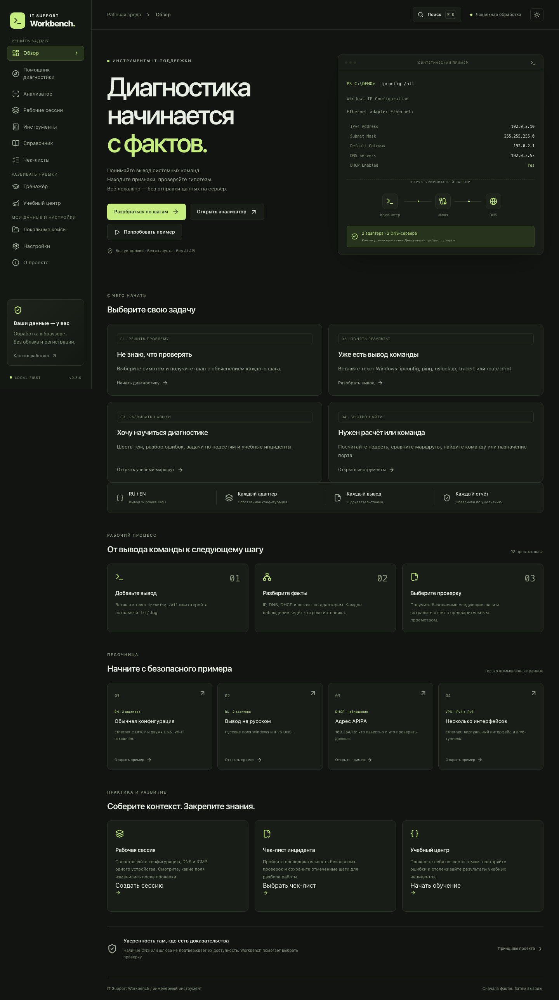
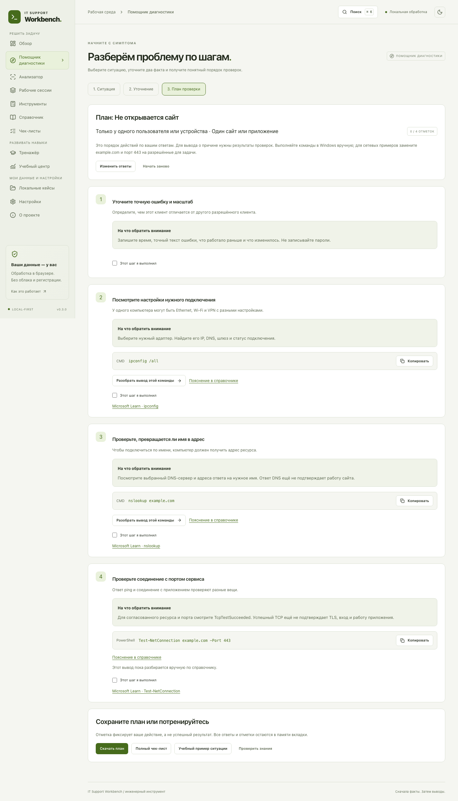
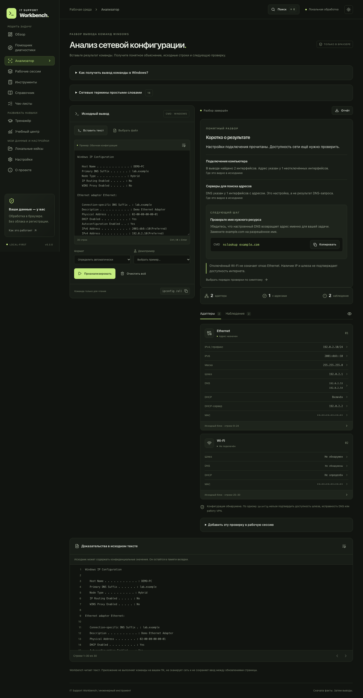
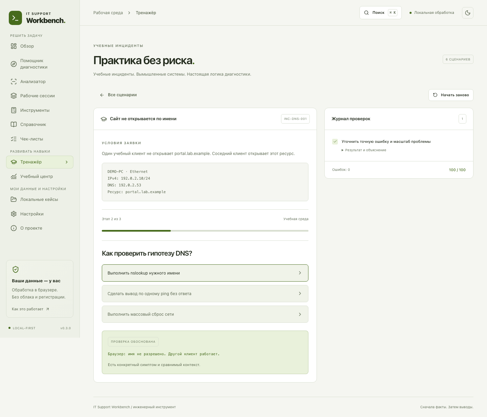
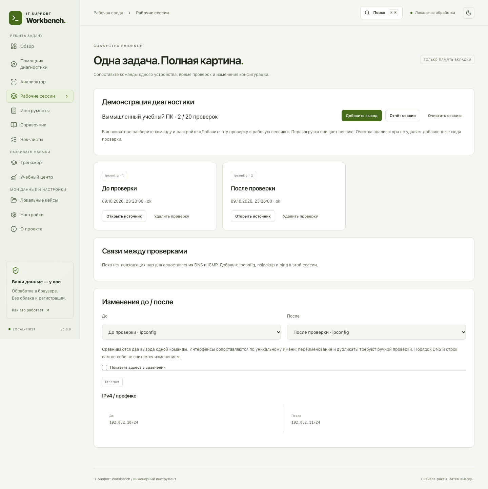
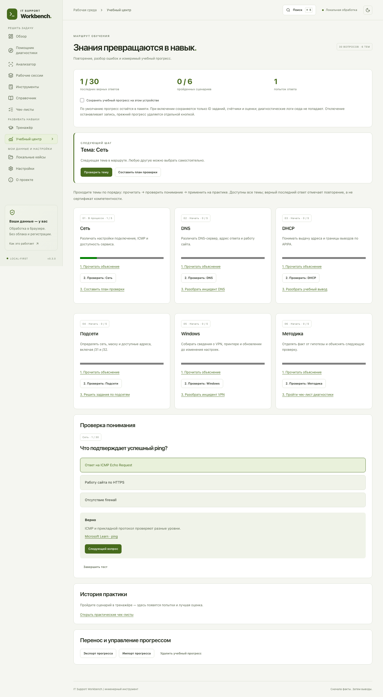

# IT Support Workbench

**Разбор терминальной попытки 11.10.2026:** конкретные следующие действия по невыполненным критериям, пять коротких упражнений и переход к самостоятельной практике или другой причине. Добавлены `help <команда>`, автоподбор сравнения до/после и экспорт сравнения. Управление контрольными точками вынесено со страницы и защищено от запоздалого чтения старой попытки. [Рабочий сценарий и границы](docs/TERMINAL_LEARNING_LOOP.md).

**Учебное рабочее место 11.10.2026:** поиск и фильтры команд, общая история и дополнение в двух режимах ввода, актуальность наблюдений, удобный переход к разбору. Отчёты получили отдельную ручную рубрику, комментарии и ограничения; выбранные доказательства сохраняются в черновике. [Что добавлено и как пользоваться](docs/TERMINAL_WORKSPACE.md).

**Исправления аудита 11.10.2026:** защита ответов и авторских черновиков, продолжение маршрута на настоящем стенде, ленивые панели. Добавлены расследование «Не открывается учебный портал» с устойчивым случайным вариантом и таблица гипотез, связанная с проверками. [Результат и ограничения](docs/AUDIT_REMEDIATION_2026_10_11.md).

**Диагностика начинается с фактов.** Локальная рабочая среда инженера IT-поддержки: структурированный разбор вывода Windows, доказательства, безопасные следующие проверки и учебные инциденты.

Vue 3 · TypeScript strict · Vite · Pinia · Tailwind CSS 4 · Vitest · Playwright · MIT

**Рабочая версия 0.6.2:** единые селекты на Reka UI во всём приложении, исправленная карта сети, адаптивные формы и обе темы. [Изменения интерфейса и проверки](docs/VISUAL_UI.md).

**Продолжение обучения:** сегодняшняя задача появляется после загрузки прогресса. Общая история показывает названия заданий, даты, понятные результаты и последние ошибки; старые и авторские материалы сохраняют совместимость. Исправлен перенос длинных заголовков на 320 px с разными системными шрифтами. [Что изменилось](docs/LEARNING_CONTINUATION.md), [следующие предложения](docs/NEXT_LEARNING_STEPS.md).

**Точечный разбор DNS-ошибок:** практикум → «Разбор ошибок». Пять известных заданий назначают короткое занятие с новой ситуацией и выбором доказательства; через сутки — другой контекст проверки. Первые ответы и срок входят в общую копию при включённом сохранении. Исправление конкретной ошибки не подтверждает весь навык. [Поведение и совместимость](docs/ERROR_PRACTICE.md).

**Учебный терминал:** 24 лаборатории, карта изменяемой виртуальной сети, DHCP/маршруты/DNS/TLS/службы и другие темы, ввод xterm.js или обычным полем, разбор и сравнение, портфолио и контрольные точки. Новое расследование включает двух клиентов, три сервера и проверку всей матрицы; изменения сопровождаются объяснением и заданием для закрепления. Откройте «Учебный терминал» в меню; начните с `help`. [Руководство и поддерживаемый синтаксис](docs/TRAINING_TERMINAL.md).

**Практикум развития:** пять траекторий, 14 навыков, 15 новых курсов, стартовая проверка, редакторы лабораторий/курсов/развилок, трассы, портфолио и повторение. Откройте **Учебный центр → Практикум развития**. [Руководство](docs/WORKSHOP_GUIDE.md), [будущий Windows/Linux-стенд](docs/REAL_LAB.md).

**Практикум 0.6.1:** продолжение обучения, четыре сквозных инцидента, шесть углублённых пакетов, устойчивые попытки/черновики и backup v2. [Сводка реализации аудита](docs/AUDIT_IMPLEMENTATION.md). Исправлены дальнейшие замечания к маршруту, конкурирующим вкладкам, возврату и оценке инцидентов; углублены предметные задания, проверен реальный Linux/HTTP-стенд. [Исправления 0.6.1 и границы Windows](docs/POST_AUDIT_FIXES.md). Ранее добавлены визуальные конструкторы курсов и развилок, общая учебная копия в настройках и шесть пошаговых заданий для своего настоящего стенда. [Что изменилось](CHANGELOG.md). Для обычной разработки достаточно `npm run check:quick` и `npm run check:feature -- workshop`; браузерная проверка выбранной функции включается через `--browser`. [Выбор проверок](docs/TESTING.md).



## Быстрый запуск

Поддерживаемый Node 22 LTS: минимум 22.22.0; `.nvmrc` и CI используют major 22. Также совместим Node 24. Для статического сайта Node нужен при разработке и сборке; опциональный companion запускается отдельно на Node.

```sh
nvm use
npm ci
npm run dev
```

Откройте <http://127.0.0.1:5173/>. Если не знаете, с чего начать, нажмите **«Разобраться по шагам»** и выберите симптом. Если уже есть вывод команды, откройте анализатор. Для знакомства без своих данных нажмите **«Попробовать пример»**, затем **«Проанализировать»**.

```sh
npm run build
npm run preview
```

Production основного приложения — статические файлы `dist/`. Основные функции работают без аккаунта, сервера обработки, API-ключей и Docker. Для явной синхронизации учебного прогресса и опционального AI есть отдельный `npm run companion`: [настройка и границы](docs/COMPANION.md). Не открывайте `dist/index.html` напрямую через `file://`; используйте статический HTTP-сервер.

## Что работает

| Раздел               | Возможности                                                                                                      |
| -------------------- | ---------------------------------------------------------------------------------------------------------------- |
| Обзор                | Демопримеры, рабочий процесс, принципы приватности                                                               |
| Помощник диагностики | 5 ситуаций, два уточнения, адаптируемый план, команды, отметки и Markdown-экспорт                                |
| Анализатор           | 7 форматов: CMD, DNS MX/TXT/SRV и JSON PowerShell; правила, evidence, понятные объяснения и отчёты               |
| Рабочие сессии       | Контекст и время, корреляция, сравнение 7 моделей, отчёт и явный обезличенный JSON-архив                         |
| Инструменты          | IPv4 CIDR /0…/32, 8 практических задач с объяснением, выбор маршрута к IPv4, 14 портов, команды для чтения       |
| Справочник           | 22 карточки и 24 термина, поиск, алгоритмы, переходы к продвинутым лабораторным и первичные источники            |
| Тренажёр             | 6 встроенных инцидентов + редактор собственных: этапы, проверки, импорт/экспорт и прохождение                    |
| Чек-листы            | 6 последовательностей диагностики, отметки шагов, Markdown-экспорт                                               |
| Учебный центр        | 6 базовых тем, 8 продвинутых модулей, 62 решения, 24 самостоятельных задания, повторение и журнал с целью недели |
| Локальные кейсы      | Opt-in IndexedDB, поиск/фильтры/сортировка, переименование, импорт/экспорт частями, два отчёта рядом             |
| Настройки            | Опциональный офлайн-доступ, обзор хранилищ, очистка диагностики и сессии, горячие клавиши                        |
| О проекте            | Границы возможностей, модель обработки и источники                                                               |

Все разделы работают. Нет страниц-заглушек, фиктивного сканирования или вымышленных метрик сети.

### Помощник диагностики

Выберите сеть, сайт, VPN, принтер или Windows Update. Уточните масштаб и контекст, включая вариант «Пока не знаю». План адаптируется: USB-принтеру не предлагается сетевой разбор, для Wi-Fi уточняется выбранное подключение, а проблема без VPN направляется к общей проверке сети.

Каждый шаг объясняет цель и признаки, содержит команду и переход к нужному формату анализатора или справочнику. Ответы и отметки сохраняются при переходах по приложению в памяти вкладки; перезагрузка или очистка в настройках удаляет их. Экспорт отражает действия пользователя, а не автоматический диагноз. Доступны связанный чек-лист, конкретный учебный инцидент и тема теста.

Рядом с командой указан тип консоли: CMD или PowerShell. Для `Resolve-DnsName`, `Test-NetConnection` и `Get-NetIPConfiguration` анализатор принимает JSON выбранных полей; готовые команды экспорта находятся в раскрываемой инструкции.



### Анализатор

- Вставка текста и локальные `.txt/.log/.json` до 2 MiB, не более 50 000 строк.
- UTF-8 с BOM; явный выбор Windows-1251 или CP866 для CMD.
- Автоматическое распознавание команды и ручной выбор формата.
- Инструкция по получению вывода в Windows и раскрываемый словарь терминов.
- Блок «Коротко о результате»: факты, ссылки на исходник, границы вывода и следующая проверка. Технические карточки доступны рядом.
- Карточки каждого адаптера, несколько IPv4/IPv6, DNS/шлюзы с продолжениями, DHCP и скрытый MAC.
- Наблюдения с confidence, ограничениями и source-line evidence; клик подсвечивает исходные строки.
- Статусы empty, processing, ok, partial, unsupported, invalid.
- Работа в Web Worker, отмена устаревшего анализа при редактировании и очистке.
- Постраничный просмотр длинных результатов: 12 адаптеров, 20 наблюдений или 80 ответов/маршрутов; полный разбор остаётся в модели и отчёте.
- Предпросмотр и скачивание `.md/.txt`; необезличенный исходник — за отдельным подтверждением.
- Тёмная/светлая темы, мобильный UI, keyboard navigation, reduced motion, Ctrl/⌘+Enter.
- 10 встроенных примеров и дополнительные RU/EN fixtures для тестов.



### Что означают результаты

`ipconfig` показывает конфигурацию. Он не доказывает доступность шлюза, DNS или VPN. APIPA при включённом DHCP — гипотеза, а не доказанная потеря интернета. Отключённый интерфейс не получает ложную критическую ошибку. Пустой шлюз у VPN-подобного интерфейса допустим.

`ping` отличает Echo Reply от Destination unreachable. Потери ICMP не доказывают выключение хоста или отказ TCP. `nslookup` отделяет сервер DNS от адресов ответа и различает timeout/NXDOMAIN/SERVFAIL. Начальный тайм-аут может предшествовать успешному ответу. `tracert` не считает пропуск промежуточного хопа разрывом маршрута. `route print` читает активные IPv4/IPv6-маршруты. Отдельный инструмент сопоставляет заданный IPv4 с таблицей по наиболее длинному префиксу, затем метрике; равные кандидаты остаются неоднозначными. Это учебная интерпретация таблицы, без проверки реального выбора Windows/VPN.

Поддерживаются стандартные выводы Windows CMD. PowerShell objects, другие локали, произвольные MX/TXT DNS-ответы и повреждённые таблицы могут дать частичный или неподдержанный результат. Один ввод — одна команда. Выводы разных команд и компьютеров не объединяются автоматически.

### Учебный тренажёр

Сценарии версионируются в JSON и проверяются Zod. Каждое действие даёт синтетический результат и объяснение. Ошибочный или несогласованный шаг не пропускает диагностику и снижает оценку. Повторное нажатие не начисляет новые баллы. Все шесть сценариев можно пройти до итогового разбора.



Камеры, кассы и весы рассматриваются теоретически и без привязки к производителю. Никакой реальной конфигурации или калибровки приложение не меняет.

### Кейсы и сравнение

В предпросмотре отчёта задайте необязательное название, например «До подключения VPN», и нажмите «Сохранить локальный кейс». Сохраняется **обезличенный отчёт**, даже если для скачивания выбран raw-режим. Ввод и исходные excerpts не записываются автоматически.

В разделе кейсов выберите два отчёта и нажмите «Сравнить». Здесь отчёты показываются рядом с датами. Для структурного сравнения используйте рабочую сессию: сохранённый текстовый кейс не содержит исходную модель.

До 100 кейсов, импорт JSON до 2 MiB, `schemaVersion: 1`, строгая схема, уникальные UUID и допустимые даты. Большой экспорт разбивается на совместимые с импортом части. Импорт сначала показывает предпросмотр; сохранение выполняется отдельной кнопкой. Совпадающие ID заменяются атомарно. Доступны поиск, фильтр команды, сортировка и переименование. Кейсы остаются до явного удаления или очистки данных браузера. Они не синхронизируются между устройствами.

### Рабочая сессия

Создайте сессию, задайте контекст устройства и подтвердите принадлежность проверок. Разберите команду в анализаторе, раскройте «Добавить эту проверку в рабочую сессию», задайте метку и время фактической проверки. Допускаются 20 проверок и 4 MiB источников в сумме.

Сессия сопоставляет последний по заданному времени `ipconfig`, `nslookup` и `ping`, показывает evidence и ограничения. Сравнение двух выводов одной команды выделяет изменения адресов, DNS, шлюзов, DHCP, потерь/RTT, DNS-ответов, цели и RTT хопов трассировки, строк маршрутов. Одноимённые неоднозначные интерфейсы не сопоставляются молча. IPv6 нормализуется; перестановка адресов не создаёт ложные изменения. Частные значения скрыты по умолчанию.

Общий Markdown-отчёт исключает исходники, пользовательские названия, контекст и метки; маскирование согласовано между всеми проверками. Сессия хранится **только в памяти** и сбрасывается при перезагрузке. Очистка анализатора не удаляет уже добавленные проверки. Очистка сессии — отдельное действие; в настройках можно очистить обе области.



### Обучение и чек-листы

Базовый маршрут учебного центра содержит 30 вопросов: сети, DNS, DHCP, подсети, Windows, методология диагностики. Есть выбор темы, повторение последних ошибок, объяснения и ссылки на источники. Результаты шести сценариев тренажёра учитываются в том же прогрессе. Хранение в IndexedDB включается явно; по умолчанию прогресс живёт в памяти. Статус показывает завершение записи перед перезагрузкой. Экспорт/импорт JSON до 256 KiB, предпросмотр и отдельное подтверждение применения.

**Продвинутый курс** добавляет восемь модулей: HTTPS/TLS, сложный DNS, Active Directory/Kerberos, SMB, GPO, IPv6, VPN/MTU и Wi-Fi. В каждом — теория, команды с объяснением цели, четыре практических решения, подсказки, разбор ошибок и Markdown-экспорт лабораторной. Всего доступны 30 базовых вопросов и 32 продвинутых решения. Материалы связаны со справочником и глобальным поиском.

**Интервальное повторение** собирает отвеченные задания с наступившим сроком: 1 → 3 → 7 → 14 → 30 дней; после ошибки — 10 минут. Раннее повторение не увеличивает положительную серию. Прогресс v1/v2 автоматически переводится в v3 с сохранением счётчиков и существующего расписания; старым ответам не приписывается история. Это учебное расписание без фоновых уведомлений. [Маршрут и правила курса](docs/ADVANCED_LEARNING.md).

Шесть чек-листов помогают пройти диагностику сети, DNS, VPN, принтера, Windows Update и оборудования. Отметки и Markdown-экспорт документируют выполненные пользователем шаги; галочка не доказывает успех проверки. Отметки сбрасываются при перезагрузке.



Глобальный поиск **Ctrl/⌘+K** открывает разделы и карточки знаний с клавиатуры. **Ctrl/⌘+Enter** запускает анализ. **Escape** закрывает диалоги.

Учебный маршрут рекомендует тему с последней ошибкой, затем первую ещё не освоенную тему. Каждая тема связывает объяснение, тест и упражнение; темы доступны без блокировки. Результат теста означает последний верный ответ, а не профессиональную квалификацию. Восемь вычислительных заданий в инструментах имеют отдельные временные счётчики; они не меняют формат сохранённого прогресса.

## Новая самостоятельная практика

В **Учебном центре → Самостоятельная практика** доступны 24 задания с собственным ответом: подсети, MTU, TTL, SRV, маршруты и планы диагностики. Объяснение появляется после проверки. **Журнал обучения** показывает последние 500 попыток, активность по дням, успешность и цель недели; постоянная запись включается общим переключателем прогресса.

В **Тренажёре → Редактор инцидентов** можно создать последовательность из 1–10 этапов, настроить результаты и объяснения, пройти сценарий и скачать/импортировать JSON. Собственные сценарии сохраняются только после подтверждения учебных данных.

В **Рабочих сессиях** появился структурированный обезличенный архив: явное сохранение, JSON-предпросмотр, импорт/экспорт и восстановление для сравнения после перезагрузки. Исходные логи и реальные имена в архив не входят.

Пошаговое руководство: [Практикум](docs/LEARNING_WORKSHOP.md), [Архив сессий](docs/SESSION_ARCHIVE.md). Скриншоты выше отражают предыдущую версию интерфейса.

## Приватность

После загрузки приложения анализ выполняется на устройстве. Диагностический ввод не передаётся в API, аналитику, AI или телеметрию. Опциональный companion отправляет только выбранный учебный прогресс; внешний AI — только явно подтверждённый вопрос и открытые материалы курса. Нет удалённых шрифтов и CDN.

По умолчанию ввод живёт только в памяти вкладки. «Очистить всё» отменяет worker, сбрасывает результаты и чтение файла. Обновление страницы не восстанавливает диагностику. Выбранные вручную локальные кейсы — отдельное opt-in хранилище и при очистке анализатора остаются.

В отчёте по умолчанию исключены hostname, имена адаптеров, описания, DNS suffix, MAC и исходник. IP вне документационных диапазонов заменяются маркерами. Пользовательские названия сохранённых кейсов входят в JSON-экспорт. Автоматическое обезличивание не гарантирует удаления всей конфиденциальной информации: просматривайте отчёт и импорт до передачи/сохранения.

**Не используйте реальные корпоративные логи без разрешения организации.** Команды справочника приложение не исполняет. Некоторые команды для чтения отправляют сетевые запросы — выполняйте их только для разрешённых ресурсов.

Офлайн-доступ включается в настройках только для production build на HTTPS/localhost. Первое включение требует сети. Service Worker кеширует только файлы сборки, включая ленивые разделы и Web Worker; логи и отчёты не входят в кэш. Обновление ждёт закрытия вкладок и не перезагружает несохранённую работу. Отключение удаляет собственную регистрацию/кэш; сохранённые кейсы и учебный прогресс управляются отдельно.

Подробнее: [модель угроз и данные](docs/SECURITY.md).

## Проверки

```sh
npm run lint
npm run typecheck
npm run test:unit
npm run test:coverage
npm run test:companion
npm run build
npx playwright install chromium firefox webkit
npm run test:e2e
# Все три движка, если они доступны в вашей ОС:
npm run test:e2e:all
npm run format:check
```

`npm run check` объединяет lint, typecheck, unit и build. `test:e2e` — Chromium; `test:e2e:all` — Chromium/Firefox/WebKit. CI на Linux запускает все три движка. Покрытие выбранной чистой логики имеет порог 85%; тесты включают негативные сценарии, сессии/diff, учебный прогресс, приватность, XSS, импорт/экспорт, офлайн, темы, доступность и вложенный путь без rewrites. Ограничение локального запуска Firefox описано в VALIDATION.

Скриншоты созданы из синтетических примеров. Для обновления запустите `npm run dev`, затем `npm run screenshots` в другом терминале. Для production preview можно задать `PREVIEW_URL`.

Подробности и актуальные результаты: [TESTING.md](docs/TESTING.md), [VALIDATION.md](docs/VALIDATION.md).

## Архитектура

```text
src/app                         bootstrap, маршруты, layout
src/pages                       двенадцать рабочих страниц
src/features/guide              планы по симптому и состояние в памяти
src/features/learning           вопросы, маршрут, интервальное повторение, opt-in прогресс
src/features/academy            продвинутые уроки, синтетические лабораторные, экспорт разбора
src/features/toolkit            выбор маршрута и практика подсетей
src/features/network-analysis   UI, Pinia, use case, Web Worker
src/features/knowledge          проверенный локальный каталог
src/features/simulator          JSON-сценарии, schema, чистый движок
src/features/cases              schema, IndexedDB repository
src/features/sessions           память сессии, корреляция, semantic diff, отчёт
src/features/learning           вопросы, progress schema, opt-in repository
src/features/playbooks          чек-листы, Markdown-экспорт
src/features/offline            явное управление Service Worker
src/domain                     типы, IP/CIDR, диагностические правила
src/infrastructure/parser       нормализация, detector, registry, парсеры
src/infrastructure/files        локальное чтение и декодирование
src/infrastructure/export       маскирование, отчёты и download shell
src/fixtures                   вымышленные примеры Windows
e2e                            сценарии production build
docs                           архитектура, безопасность, тесты, roadmap
```

Бизнес-логика отделена от Vue, DOM и сети. Номера строк 1-based, нормализация сохраняет текст кроме BOM/переносов. Evidence viewer показывает окна по 80 строк. UI не интерпретирует адреса regex-ами.

Иконки поставляются пакетом `@lucide/vue`: актуальный преемник указанного в ТЗ `lucide-vue-next`. Все точные версии закреплены в `package-lock.json`.

Подробнее: [ARCHITECTURE](docs/ARCHITECTURE.md), [PARSERS](docs/PARSERS.md), [CONTRIBUTING](docs/CONTRIBUTING.md), [ROADMAP](docs/ROADMAP.md).

Для практического обучения: [PRACTICE.md](docs/PRACTICE.md).

## GitHub Pages

Исходники опубликованы в [GitHub](https://github.com/D1ug0/it-support-workbench). Результаты удалённых проверок доступны в [Actions](https://github.com/D1ug0/it-support-workbench/actions). Публикация сайта Pages запускается отдельно по шагам ниже.

Подготовка первого репозитория, название и готовые поля GitHub: [GITHUB_PREPARATION.md](docs/GITHUB_PREPARATION.md).

1. Создайте репозиторий и добавьте проект; публикация требует вашего решения.
2. В Settings → Pages выберите Source: **GitHub Actions**.
3. Дождитесь успешного workflow **CI** для последнего коммита в `main`.
4. Запустите workflow **Deploy GitHub Pages** вручную, выбрав `main`.

Deploy разрешён только из `main`, проверяет успешный CI для того же коммита и пересобирает этот коммит из lockfile перед загрузкой `dist/`, без повторного запуска тестов. Используется относительный `base: './'` и hash routes, поэтому имя репозитория не нужно зашивать в код. Права записи `pages`/`id-token` выдаются только deploy-job. На управляемом хостинге добавьте HTTP security headers; meta CSP — частичная защита для Pages.

Подготовка проекта не выполняет commit/push или развёртывание автоматически. Появление веток Dependabot и их удаление после слияния описаны в [GITHUB_PREPARATION.md](docs/GITHUB_PREPARATION.md).

## Следующее развитие

Состояние рабочей версии 0.6.1 и оставшиеся внешние проверки описаны в [WORKSHOP_GUIDE.md](docs/WORKSHOP_GUIDE.md) и [DEVELOPMENT_PLAN.md](docs/DEVELOPMENT_PLAN.md). Реальные Windows fixtures нужно получить на будущем стенде; текущие примеры синтетические. Подробный разбор устранённых недостатков и границ: [IMPROVEMENTS.md](docs/IMPROVEMENTS.md). Companion и AI опциональны; remote agent и выполнение системных команд не реализованы.

## English summary

IT Support Workbench is a local-first IT support analyzer and learning environment. It includes evidence-based Windows parsing, diagnostic sessions, network tools, 24 simulated terminal labs, skill paths, advanced courses, branching incidents, authoring tools, trace exercises, opt-in progress, investigation portfolios, and offline access. An optional self-hosted companion supports explicit progress synchronization and educational explanations. System commands are never executed by the browser.
