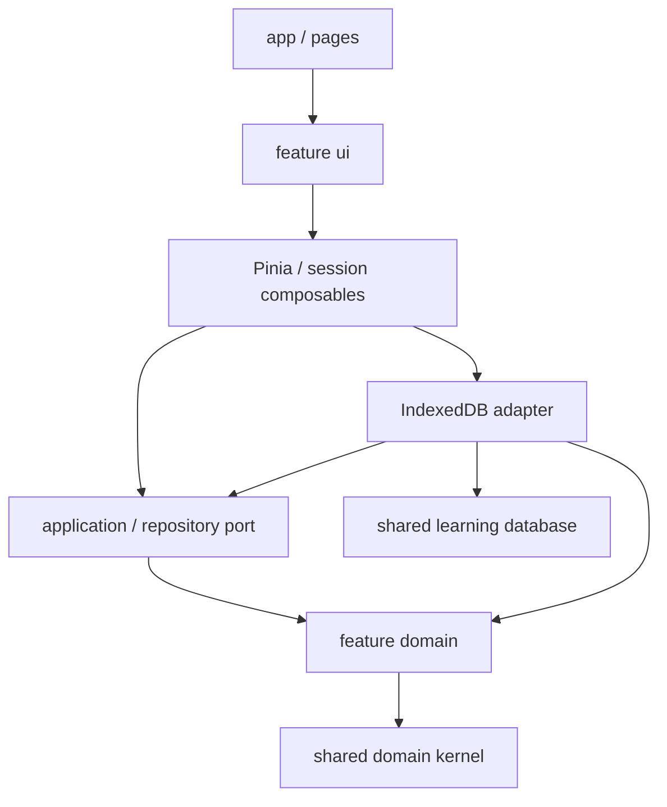

# Архитектура IT Support Workbench

Актуальное устройство после постепенного рефакторинга 12.10.2026. Стек: Vue 3, TypeScript strict, Vite, Pinia, Vue Router hash, Dexie, Tailwind CSS. Версии закреплены в lockfile. [Аудит и результаты проверок](ARCHITECTURE_AUDIT_2026_10_12.md).

## Структура и ответственность

```text
src/
  app/                         запуск, router, композиция и глобальный поиск
  pages/                       сборка публичных возможностей нескольких features
  features/
    workshop/
      index.ts                 чистый публичный контракт прогресса и материалов
      domain/                  схемы, правила, оценивание и преобразования
        professional/          движок, рубрика, совместимость и отчёты инцидентов
      application/             рекомендации, backup-контракт и порт репозитория
      model/                   Pinia и composables рабочих процессов
        index.ts               отдельный публичный вход store
      infrastructure/          репозитории IndexedDB и HTTP companion
      ui/                      learning / authoring / investigation / stand / exchange
      __tests__/               интеграционные проверки частей workshop
    learning/                  основной и совместимый учебные маршруты
    terminal/                  виртуальные команды, сеть и контрольные точки
    network-analysis/          ввод, сценарий анализа и Worker adapter
    ...                        остальные ограниченные возможности
  domain/                      общий предметный kernel, без Vue и хранилища
    learning/                  SkillId и совместимость ID попыток
    diagnostics/parsers/       чистые парсеры Windows/DNS/PowerShell
    diagnostics/redact.ts      чистое обезличивание адресов
    rules/                     интерпретация наблюдений
    types/                     форматы диагностики
  infrastructure/
    learning-storage/          общий экземпляр и схема учебной IndexedDB
    files/                     чтение локальных файлов
    export/                    диагностические отчёты и скачивание
  shared/                      общие UI-примитивы, стили и технические функции
```

Пять слоёв создаются там, где разделяют реальные обязанности. Небольшому каталогу или калькулятору не нужны пустые `application` и `infrastructure`. У остальных features сохранены именованные входы; публичные файлы перечислены в `scripts/architecture/config.mjs`.

| Слой             | Ответственность                                                 | Допустимые зависимости                                                          |
| ---------------- | --------------------------------------------------------------- | ------------------------------------------------------------------------------- |
| `ui`             | Разметка, доступность, отображение ошибок и явные действия      | Собственная model, чистые функции, операции репозитория для небольших сущностей |
| `model`          | Реактивное состояние, очередь, загрузка и жизненный цикл сессии | domain/application; конкретные адаптеры при композиции                          |
| `application`    | Сценарии над правилами и публичными контрактами модулей; порты  | domain/application; без Vue, Dexie и браузерного I/O                            |
| `domain`         | Типы, Zod-схемы, оценивание, чистые изменения снимков и отчёты  | Собственный domain, общий kernel и Zod                                          |
| `infrastructure` | Транзакции, чтение/запись, HTTP и Worker transport              | domain, application-порты, платформенные библиотеки                             |



Это ответственность, а не статический цикл импортов: адаптер импортирует **тип** порта. Для небольших записей UI может вызвать именованную операцию репозитория; компоненты и domain не получают Dexie или учебную таблицу.

## Публичные API

- `features/workshop/index.ts` экспортирует только доменные контракты прогресса, материалы и политику. Native Node companion может использовать его без Vue/IndexedDB в runtime-цепочке.
- `features/workshop/model/index.ts` экспортирует `useWorkshopStore` и `createWorkshopStore`. Не добавляйте их в доменный barrel.
- `application/recommendations.ts` и `application/competencies.ts` — публичные сценарии для обучения и терминала.
- Переиспользуемые панели имеют отдельные публичные `.vue`-входы. `WorkshopPanel` загружает остальные панели отдельными `defineAsyncComponent`/`import()`; barrel всех компонентов отсутствует.
- Внутри feature импортируйте конкретную реализацию, а не собственный публичный `index.ts`, чтобы не создавать циклы.
- Между features используйте только файлы из `publicEntries` и направления из `featureDependencies`. Новый вход требует объяснения роли и владельца; не расширяйте списки автоматически по нарушениям.
- `shared` и общий kernel не импортируют features. Глобальный `CommandPalette`, который связывает несколько features, находится в `app/components`.
- Alias пока не используются. Для их введения обновите TypeScript/Vite и архитектурный resolver. Native Node-цепочка companion требует явные `.ts`-расширения.

Обучение, практикум и терминал реализуют общий продуктовый процесс и сохраняют семантические связи. Публичные контракты ограничивают их; отсутствие циклов файлов не означает полной независимости возможностей.

## RAM, репозитории и Local-First

`useWorkshopStore` владеет RAM, согласием, очередью, ревизией и ошибками. `domain/progressCommands.ts` не знает о Pinia, браузере или IndexedDB: событие, теория и assessment формируют один новый снимок; повторное событие не добавляет доказательства.

`application/workshopRepository.ts` задаёт небольшой порт. `infrastructure/workshopRepository.ts` выполняет CAS и транзакции. `createWorkshopStore(repository)` позволяет проверить RAM, отказ и очередь без реальной БД; обычный store связывает существующий локальный адаптер. Разные тестовые порты используют отдельный Pinia instance: ID store сохранён.

Снимок валидируется и отделяется **до** постановки записи в очередь. Ревизия увеличивается после успешной транзакции. Отказ сохраняет RAM-результат; UI получает `SaveResult`. Прогресс не записывается до opt-in; материалы, отчёты и черновики сохраняются явным действием.

Перед запуском каждой записи очередь повторно проверяет согласие. Отключение сохранения отменяет ещё не начатые снимки; быстрое повторное включение не возвращает их в очередь. Уже начатая транзакция завершается, затем сериализованно сохраняется отключение. Учебные результаты остаются в RAM.

Черновики, профессиональные попытки и отчёты стенда имеют отдельные репозитории. UI использует `read…`, `get…`, `save…`, `delete…`. Схема черновика отделена от адаптера; доменный professional API не реэкспортирует IndexedDB. Проблемные исходные записи сохраняются для восстановления.

## База и совместимость

`infrastructure/learning-storage/database.ts` владеет БД **`it-support-workbench-workshop`**, версия **4**. Она общая для learning, workshop и авторских сценариев: backup должен заменять связанные коллекции атомарно. Это технический адаптер вне предметного API workshop.

При рефакторинге сохранены имя БД, версии 1–4, 11 таблиц и индексы; форматы прогресса, материалов, backup v1/v2, checkpoint и попыток; прежние миграции, ID store, ключи opt-in, токены и CAS. Бюджет — 12 MiB, backup — до 16 MiB. Предпросмотр и проверка токена предшествуют restore; ошибка откатывает всю транзакцию. История отчёта хранит до трёх прежних редакций; исторические оценки не пересчитываются. Перенос исходников не требует миграции данных.

## Загрузка, офлайн и приватность

Три крупные панели содержат представление; `useProfessionalSession`, `useInvestigationSession` и `useStandSession` владеют формами, маршрутами, отменой запоздалых операций и сохранением. Выполнение и оценивание остаются чистыми функциями. Сохранены lazy routes, async панели, KeepAlive попытки и отдельный chunk инструкций стенда.

Анализ выполняется через `network-analysis/infrastructure/analysis.worker.ts`; `application/analyzeOutput.ts` вызывает чистые парсеры kernel. Очистка/редактирование прекращает старый worker. Сохранены лимиты 2 MiB/50 000 строк и пагинация.

Service Worker включается пользователем и кэширует только GET к allowlist собственных статических файлов без query. Учебные записи, raw logs, credentials и внешние API не входят в кэш. Companion и внешний AI остаются опциональными, с явным адресом/согласием; автосинхронизации нет. Новые серверы, телеметрия и фоновые запросы не добавлены.

## Автоматические ограничения

`npm run check:architecture` разбирает TypeScript AST, script-блоки Vue, static/type/dynamic imports и реэкспорты. Проверяет публичные входы, направления между features, зависимости слоёв и полный runtime-путь из чистых слоёв, в том числе через фасады. Запрещает Vue/Pinia/Dexie и браузерный I/O в domain/application, feature-зависимости в shared/kernel, импорт app/pages из features, тестов из production и учебных таблиц из UI. Проверяет разрешимость относительных модулей, runtime-циклы и native Node-расширения.

Проверка включена в `check`, `check:quick`, `check:full` и CI; checker покрыт 19 тестами. Обращения к браузерным API проверяются также через строковый ключ (`globalThis['fetch']`), деструктуризацию и прямое присваивание API переменной. Native Node-проверка требует расширения `.ts` и для ленивых импортов. Checker проверяет файловые зависимости и статические формы обращений, а не все runtime-вызовы или потоки данных. Новые aliases/формы загрузки требуют расширения resolver и его тестов.

## Добавление возможности

1. Выберите владельца и минимальный слой. Реактивное состояние формы не относится к domain.
2. Бизнес-правило оформите чистой функцией и проверьте существенные границы/регрессии.
3. I/O оформите конкретным адаптером. Порт добавляйте для настоящей сменяемой зависимости, а не каждого helper.
4. При изменении записи спроектируйте миграцию, обратную совместимость, бюджет и CAS/restore отдельно от переноса файлов.
5. Выполните `npm run check:quick`, тесты области и браузерные сценарии изменённого UI/сохранения/офлайна. Перед выпуском — `npm run check:full` в среде с тремя рабочими движками.

Команды: [TESTING.md](TESTING.md). Участие: [CONTRIBUTING.md](CONTRIBUTING.md). Продуктовый сценарий: [LEARNER_JOURNEY.md](LEARNER_JOURNEY.md).
